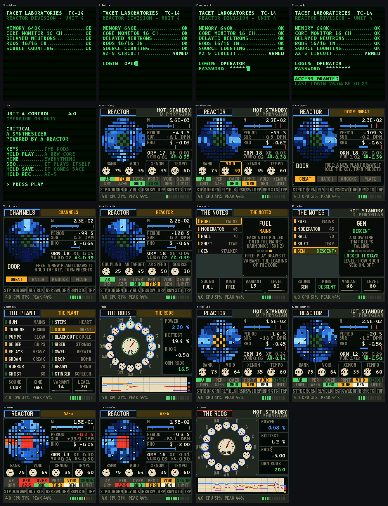

# CRITICAL

**A synthesizer powered by a reactor.** Free custom firmware for the M-VAVE FM-1.

The sound is not played. It is produced by a model of a nuclear core, the way a power station produces its current. The sixteen white keys are its fuel channels, and your hands pull the control rods. The core rises, settles, poisons itself with xenon, and drifts on its own for minutes. Push the steam too far, press AZ-5, and it can run away.



**[Install it from your browser →](https://isod89.github.io/critical-fm1/)** (Chrome or Edge, USB cable, about ten minutes)

**[Watch the operator orientation tape →](https://github.com/isod89/critical-fm1/releases/download/v4.0/critical-4.0-tape8.mp4)** (4 min 24: the instrument's own sound and screen)

## What it does

- **Sixteen fuel channels in a ring**, one under each white key, tuned to the key and scale you choose. The ring is laid out in fourths: a hot channel warms its neighbours.
- **Each channel is a small reactor**: six groups of delayed neutrons (Keepin's U-235 data), the prompt jump approximation, reactivity in dollars, fuel temperature, steam and xenon.
- **A channel sounds the way a detector hears its flux.** At low power, single counts struck into the channel's resonances. As the flux rises, the counts become a grain, then a tone that brightens with the power, as Cherenkov light does.
- **The regulator (AR)** holds the total power, so raising one channel takes power from the others. The harmony rearranges itself.
- **Xenon** poisons a channel after you let it go, and the poison moves around the ring. With no hands on the keys, the core never quite repeats itself.
- **Void**: a positive steam coefficient. Past a point, the channels ring, boil and run away.
- **AZ-5** (hold REC one second) drives every rod in, graphite tips first. With high steam and a low margin, the core can go prompt critical: a blow, a cut, then a cold restart.
- **The plant around it** follows the reactor's heat: turbine, pumps, generator hum, dosimeter, relays, groans. Eleven black keys strike the plant's events: steps, door, relays, blackout, riser, swell, drop, braam, stinger, trip.
- **The hall** replays six seconds of what you played into a room that keeps only its own resonances, generation after generation.
- **GEN** (SEQ) lets the core play itself: seven figures drawn from what horror film scores do with notes.
- **A control room on a 240 × 240 screen**: the core's map in Cherenkov blue, power on eight decades, period, startup rate, reactivity, operating margin, twelve annunciators, a wall of sixteen rod dials and a four-pen recorder. At power-on, the operator logs into the plant's terminal.
- **Hold PLAY** for a new plant (a new draw of every sound), lock what you like, **hold SAVE** to keep it all.

The full manual is in **[docs/GUIDE.md](docs/GUIDE.md)**.

## Install

CRITICAL installs from a web page over USB MIDI, through **[m-bootloader](https://github.com/jvitkauskas/m-bootloader)**'s MIDI MODE. The page walks you through three steps:

1. **Install m-bootloader (once).** It is required for your safety. It checks every firmware before starting it, and if an install is interrupted or a firmware is damaged, the FM-1 opens a recovery menu instead of hanging. You can always reinstall from a browser, or use USB download mode, without opening the case. The page explains both ways to install it: with M-VAVE's own M-UPGRADE app, or with [M-Flasher](https://github.com/jvitkauskas/m-flasher).
2. **Back up** the whole flash (1 MB) to a file, so you can put the FM-1 back exactly as it was.
3. **Install CRITICAL.** The FM-1 restarts on the plant's terminal.

Open **https://isod89.github.io/critical-fm1/**, or download `installer-critical-4.0.html` from the [latest release](https://github.com/isod89/critical-fm1/releases/latest) and open it from your disk.

**Going back:** restore your backup with M-Flasher, or install any other firmware that has a MIDI MODE installer.

## Building

### On a PC (the sound, the instrument, the screens, the tests)

Any C11 compiler (gcc or clang) on Linux or macOS, and Node.js for the installer test:

```sh
./build.sh                 # runs the tests, a piece written to build/pc/play3.wav, and the screens (build/pc/shots3/*.ppm)
SOAK_MIN=2 ./build.sh      # shorter random-play soak tests (30 minutes each by default)
```

| Test | What it does |
|---|---|
| `tests/flow3.c` | every way the hands go through the instrument, checked one by one (rods, pages, HOLD, AZ-5, the board, locks, draws, GEN, SAVE) |
| `tests/play3.c` | a 3 min 20 piece played through the instrument as hands would, to a WAV |
| `tests/soak3.c` | a restless musician at random for N minutes: every sample a number, nothing over the limiter, no denormals in silence |
| `tests/shots3.c` | the screens as the FM-1 draws them |
| `tests/core4.c` | the reactor alone, a scripted session with its panel readings |
| `tests/kinds3.c` | every kind of every sound, alone, each to its own WAV |
| `tests/film4.c` | the instrument filmed from a script of gestures (sound and screen, 30 pictures a second) |
| `tests/install_sim.js` | the installer page run in Node against a simulated m-bootloader |

### The firmware

You need the [pi32v2 LLVM toolchain](https://github.com/jvitkauskas/pi32v2-llvm), release `pi32v2-23.1.5-2`. Nothing from JieLi is needed. On Linux x86-64:

```sh
curl -fLo toolchain.tar.xz https://github.com/jvitkauskas/pi32v2-llvm/releases/download/pi32v2-23.1.5-2/pi32v2-llvm-23.1.5-2-linux-x64.tar.xz
echo 'cb896562418a2be93edb9bac26af4bc81a106a32974002a78e6b9fc203c93990  toolchain.tar.xz' | sha256sum -c
mkdir toolchain && tar -xJf toolchain.tar.xz -C toolchain --strip-components=1
fw/build.sh                                            # or: fw/build.sh /path/to/toolchain/bin
node tests/install_sim.js build/fw/installer-critical-4.0.html build/fw/critical.area
```

This writes `build/fw/critical.area` (the application area) and `build/fw/installer-critical-4.0.html` (the installer page, the firmware inside, one file).

The firmware runs from RAM: m-bootloader calls a small stub in the flash window, which copies the image to RAM and starts it. The sound runs at half the FM-1's rate (the hall and the plate at a quarter) and is stepped up at the end. There is no C library and no interrupt: one loop fills the audio buffer block by block, with the panel and the screen in between. If the processor runs short, the instrument lightens itself.

## Source

| Path | What |
|---|---|
| `src/synth.c` | the sound: the core, the channels, the moderator, the plant, the gestures, the hall, the plate, the limiter |
| `src/inst.c` | the instrument: keys, buttons, knobs, pages, scenes, the board, locks and draws, GEN, SAVE |
| `src/screen.c` | the screens: the terminal, the desk, the board, the rods' wall |
| `app/` | drawing a tile at a time, the fonts |
| `hal/fm1/`, `core/` | the FM-1's hardware layer (screen, panel, audio, flash, ADC, second core) and the small C library |
| `fw/` | the firmware's entry, linker scripts, build |
| `web/` | the installer page and the package format m-bootloader reads |
| `tools/` | the fonts, the application area, the installer page |
| `tests/` | the tests above |

## Status

CRITICAL is unofficial: it is not made, endorsed or supported by M-VAVE. Installing third-party firmware is at your own risk. Please report problems in the [issues](https://github.com/isod89/critical-fm1/issues), with what the screen shows (the CPU and PEAK readings at the bottom help).

TACET Laboratories is fictional. The reactor model follows real physics, simplified and sped up: it is an instrument, not a simulator.

## Credits and licences

- CRITICAL: GPL-3.0 (see [LICENSE](LICENSE)).
- [m-bootloader](https://github.com/jvitkauskas/m-bootloader), [M-Flasher](https://github.com/jvitkauskas/m-flasher) and the [pi32v2 LLVM toolchain](https://github.com/jvitkauskas/pi32v2-llvm) are by Julius Vitkauskas (MIT). CRITICAL includes none of their code: the installer page speaks m-bootloader's MIDI MODE protocol as its specification describes.
- Fonts: [B612 Mono](https://github.com/polarsys/b612) and [Barlow Condensed](https://github.com/jpt/barlow), SIL Open Font License 1.1 (`assets/fonts/`).
- Reactor physics: the US DOE Fundamentals Handbook, *Nuclear Physics and Reactor Theory*; Keepin's delayed neutron data. Sound: inspired by recordings made in nuclear plants, Jacob Kirkegaard's *4 Rooms* and Alvin Lucier's *I Am Sitting in a Room*.
